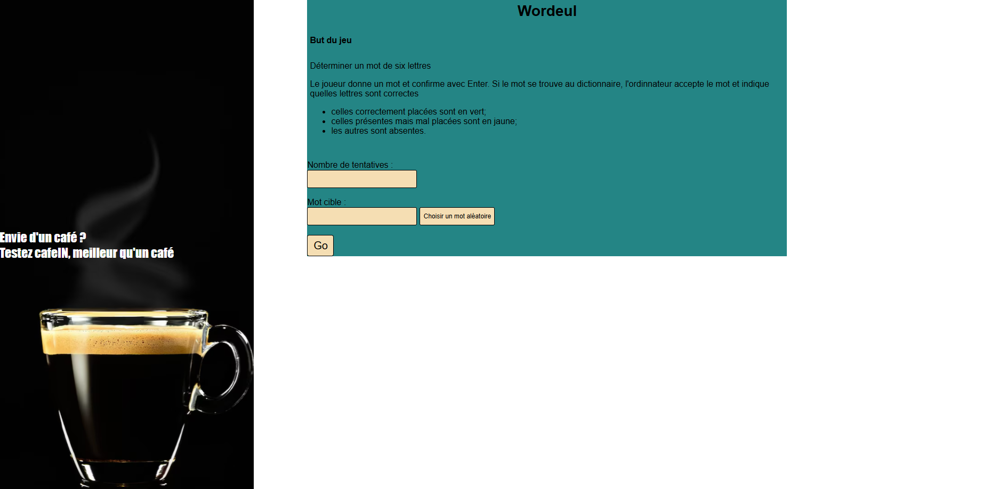
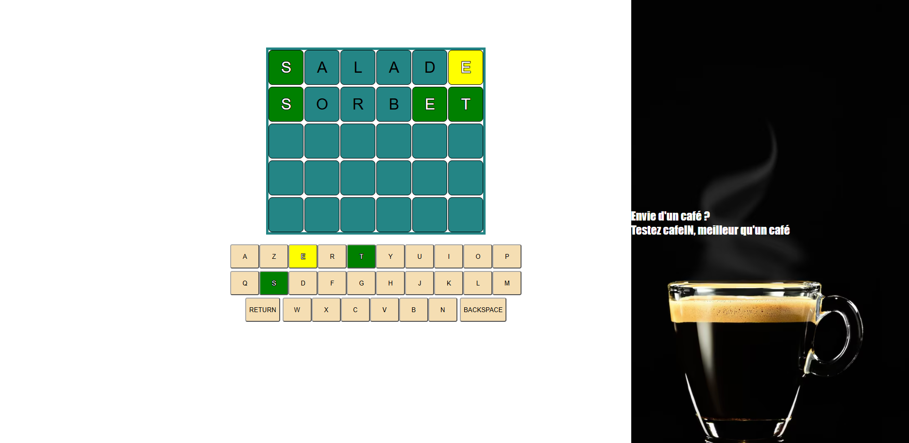

# Wordeul

Jeu de lettres inspiré de Wordle, réalisé dans le cadre d'un projet académique en développement web.

## Description

Wordeul est un jeu de devinettes dans lequel le joueur doit trouver un mot de six lettres en un nombre limité de tentatives.

Après chaque proposition, le jeu indique la position des lettres :

- les lettres correctement placées sont affichées en vert ;
- les lettres présentes dans le mot mais mal placées sont affichées en jaune ;
- les lettres absentes du mot sont affichées comme incorrectes.

Le mot cible peut être saisi manuellement ou sélectionné aléatoirement dans le dictionnaire du jeu.

## Technologies utilisées

- HTML5
- CSS3
- JavaScript
- ESLint

## Fonctionnalités

- Configuration du nombre de tentatives, de 2 à 8 ;
- Choix manuel d'un mot cible de six lettres ;
- Sélection aléatoire d'un mot depuis le dictionnaire ;
- Validation des propositions avec la touche Enter ;
- Suppression d'une lettre avec Backspace ;
- Clavier virtuel AZERTY ;
- Utilisation du clavier physique ;
- Vérification des mots dans le dictionnaire ;
- Gestion des lettres répétées ;
- Animation lorsqu'un mot n'est pas reconnu ;
- Message de victoire ou de défaite en fin de partie ;
- Réinitialisation de la grille pour commencer une nouvelle partie.

## Architecture

Le projet est organisé autour d'une page HTML, de scripts JavaScript spécialisés et de feuilles de style dédiées :

- **Page principale** : `wordeul.html` contient la structure de l'interface et les différents éléments du jeu ;
- **Logique du jeu** : `js/wordeul.js` gère la grille, le clavier, la validation des mots et les règles de comparaison ;
- **Formulaire** : `js/formulaire.js` gère la configuration et le lancement d'une partie ;
- **Fenêtre modale** : `js/modal.js` gère les messages de victoire et de défaite ;
- **Styles** : le dossier `style/` contient les feuilles de style du jeu, du formulaire, de la fenêtre modale et de la structure générale ;
- **Ressources** : le dossier `images/` contient les images utilisées par l'interface.
## Aperçu

### Menu



### Plateau de jeu



## Dictionnaire

Au chargement de la page, le jeu récupère le dictionnaire des mots de six lettres depuis l'API GitLab du projet. Une connexion Internet est donc nécessaire pour valider les propositions et choisir un mot aléatoire.

## Installation

### Prérequis

- Un navigateur web récent ;
- Une connexion Internet pour charger le dictionnaire ;
- Node.js et npm uniquement si vous souhaitez utiliser les outils de développement du projet.

### Lancer le jeu

Cloner le dépôt :

```bash
git clone https://github.com/madmadiabdallah21-max/wordeul.git
```

Se placer dans le dossier du projet :

```bash
cd wordeul
```

Ouvrir ensuite `wordeul.html` dans un navigateur web.

Pour utiliser un serveur local, vous pouvez également lancer le projet avec l'extension **Live Server** de Visual Studio Code.

## Utilisation

1. Choisir le nombre de tentatives ;
2. Saisir un mot cible de six lettres ou utiliser le bouton de sélection aléatoire ;
3. Cliquer sur **Go** pour lancer la partie ;
4. Entrer une proposition avec le clavier virtuel ou le clavier physique ;
5. Valider avec **Enter** et interpréter les couleurs affichées ;
6. Utiliser **Backspace** pour corriger une proposition avant sa validation.